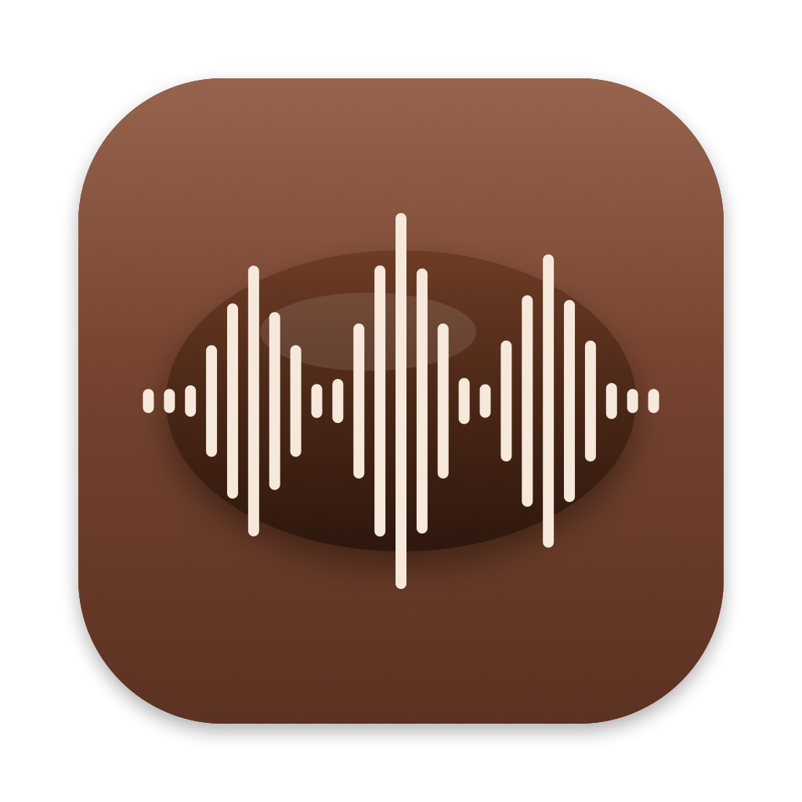
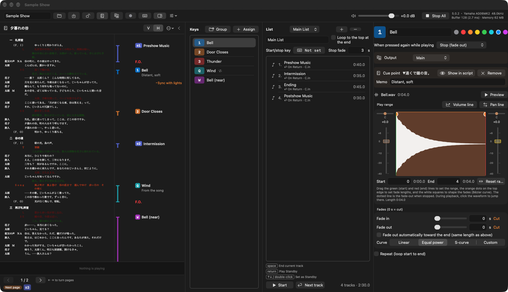
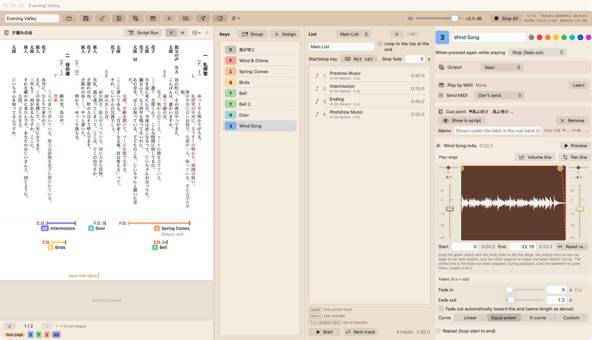
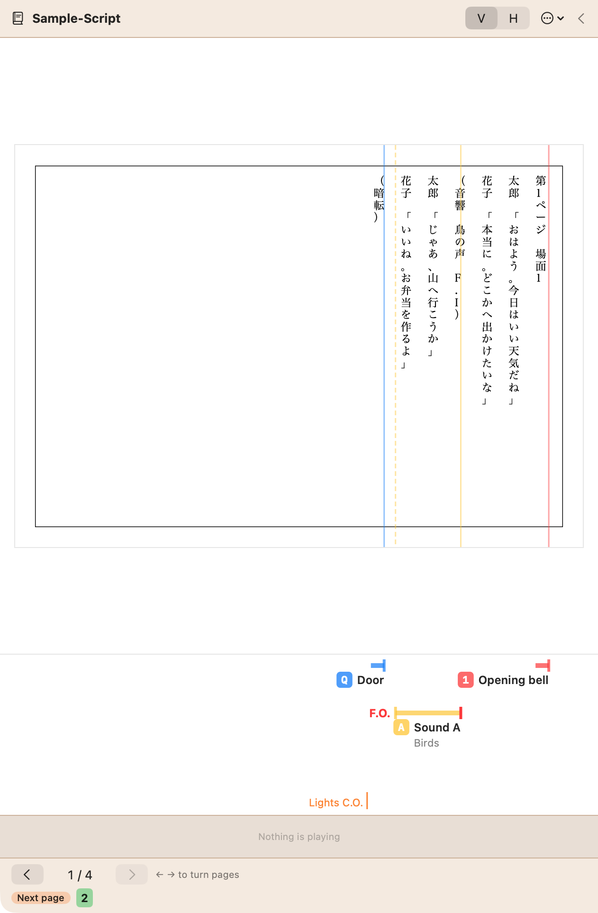
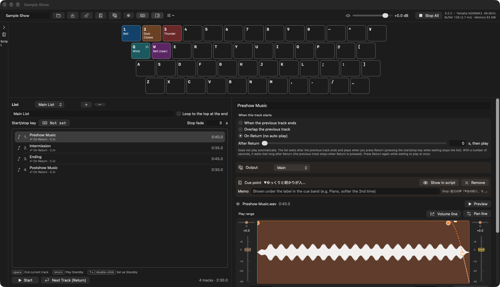
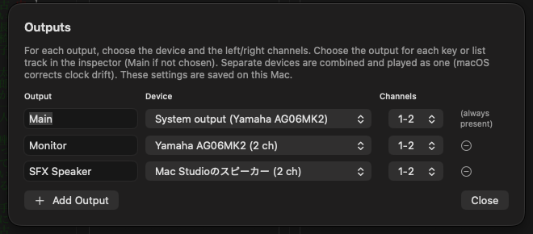
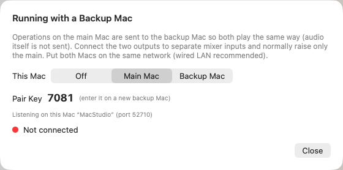
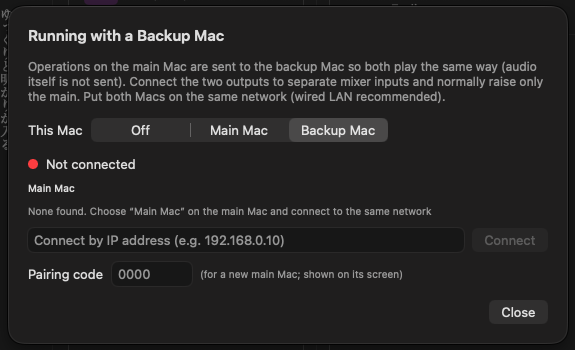
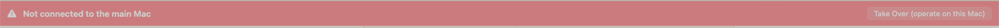

<!-- _class: lead -->
<!-- _paginate: false -->
<!-- _footer: "" -->

# CacaoSoundCues Pro Manual

Script-linked sound cue playback for the stage
Version 5.0.2 / October 2026

---

## What this manual covers

1. What Pro adds (differences from the free version)
2. Importing and displaying a script
3. Linking cues to the script (the cue band)
4. Following the script and playing from the band during a show
5. Outputs (sending sounds to several speakers or devices)
6. Running with a backup Mac
7. What is saved, and troubleshooting

> For the basics (assigning sounds, fades, lists, Show Mode), see the free **CacaoSoundCues Manual**. Pro works the same way.

---

## What Pro adds

### Script link

- Shows a ScenarioWriterSolo script (.scwd) or an ordinary **PDF** script beside the main window
- Links keys and list tracks to **positions in the script text**
- A **cue band** under each page, like a sound operator’s marked-up script

### Outputs

- Choose the speaker (device and channels) for each key or track

### Running with a backup Mac

- Operations on the main Mac are sent to a second Mac, which plays the same way
- If the main Mac stops, carry on with the backup

### Compatibility with the free version

- Cue sheets (.ccsc) are the same format. A cue sheet made in Pro opens safely in the free version (script links and other Pro data are simply ignored)

---

## 1. Installing and launching

1. Double-click **CacaoSoundCuesPro.zip** to unzip it
2. Move **CacaoSoundCuesPro** into the **Applications** folder
3. Double-click to launch

It can sit next to the free version (CacaoSoundCues). Settings are kept separately.

**If macOS says the developer cannot be verified**
macOS 15 or later: close the alert, then click **Open Anyway** in **System Settings › Privacy & Security**.
macOS 14: **right-click the app → Open → Open**.

**If asked to allow finding devices on your local network**
This is used to connect to the backup Mac on the same network. Click **Allow**.

---

## 2. The main window

Left: script panel (cue band below, then the waveform of what is playing and page turning) / Middle: key list and list / Right: settings of the selected sound (the “Output” and “Cue point” rows are Pro features)

---

## 3. Top bar buttons

| Button | What it does |
|---|---|
| **Script** | Show or hide the script panel |
| **Output** | Set up outputs (devices and channels) → section 9 |
| **Backup** | Running with a backup Mac → section 10. Dot color: gray = off, green = connected, orange = cue sheets differ, red = disconnected |
| **Keyboard** | Show or hide the keyboard (hidden: a list of assigned keys) |
| **Inspector** | Show or hide the settings on the right. Hiding it gives the script more room |

When the window is narrow (or the labels are long, as in English), the buttons show icons only. Hover to see the name.

---

## 4. Importing a script

1. In the script panel, click **⋯ → Import Script…**
2. Choose a ScenarioWriterSolo script (**.scwd**) or a **PDF** (see “PDF scripts” two pages on)
3. The script is copied into the cue sheet

- After editing the script, use **Reload Script**
- Lines are found by an ID that ScenarioWriterSolo gives each line, so links stay put when the script is edited

### Display (⋯ menu)

- **V / H**: vertical or horizontal writing
- **Text Size** (upper limit), **Line Spacing**, **Letter Spacing**
- **Character Name Width**, **Characters per Line**: normally as set in the script; can be changed for this cue sheet only

Lines wrap by the script’s format (name column + characters per line), so they break where they do on paper. If a line does not fit, the text gets smaller. Display settings are saved in the cue sheet.

---

## Vertical and horizontal

Vertical: the cue band is under the page (lines run right to left). Horizontal: it is on the right.

---

## PDF scripts (other than ScenarioWriterSolo)

- **Import Script…** also accepts a **PDF** (each page shown as it is)
- **Text size and spacing cannot be changed**
- **V / H** is the script’s direction (V: band below, <kbd>←</kbd> is next / H: band on the right)
- Page turning and the cue band work as with a .scwd script
- A **colored line** is also drawn on the page at each cue

Choose V / H before linking (changing it later moves the lines). Password-protected PDFs cannot be read.

---

## 5. Turning and scrolling pages

### Turning pages

- <kbd>←</kbd> <kbd>→</kbd> or ‹ › at the bottom
- In vertical writing, as in a Japanese book, <kbd>←</kbd> is the next page

### Scrolling

- Mouse wheel, **horizontal scroll** (side wheel) or trackpad scroll the pages like a scroll of paper
- They stop where you stop (you can view across two pages)

### Panel width

- Drag the divider between the script and the main window
- Drag to the right edge to **fill the window** with the script (the main window is hidden; keys and Return still work)
- Click **‹** in the panel header to **fold** the script to the left (click the thin strip to open it)

### Next page

- **Next page** at the bottom shows the cue badges on the next page

---

## Folding the script

When folded, the main window takes the script’s space. Click the thin strip on the left to open the script again.

---

## 6. Linking cues

### In the band (recommended)

1. Select a key or list track
2. **Right-click** the **cue band** under the page at that point
3. Choose **Cue “…” Here**

The line starts exactly where you clicked (even between lines).

### In the text

- You can also right-click the script text to link
- The **Cue point** row in the inspector shows or removes the link

### Stop point (end of the line)

- Right-click the band → **Stop Here**
- The line is drawn to that point and marked **F.O.** (fade out) or **C.O.**
- Lines that cross a page continue on the next page

### Adjusting a line

- **Drag** the vertical mark at the start or end of a line
- **Double-click** a mark to put it back on the text

---

## Reading the cue band

- Badge: **the key to press** (in the key’s color) or a list track (**≡** and number)
- A **memo** under the name (e.g. “Distant, soft”). Write it in the inspector’s Memo or by right-clicking the band
- Line: from the cue to the stop point. It gets thicker while playing
- Orange text: a **note** not tied to a cue (e.g. “Sync with lights”)

> Just like pencilling A, S and so on into a paper script, you can see directly what to press.

---

## Right-clicking the band

| Where you right-click | What you can do |
|---|---|
| Empty space | **Cue the selected key or track here** / **Stop here** / **Write a note here…** |
| Badge or line | **Play** / **Stop** (while playing) / Write memo / Stop here Reset line position / Remove stop point / **Unlink** (remove from the script) |
| A note | Edit memo / Delete memo |

In Show Mode, only Play and Stop are available.

---

## 7. Using the script during a show

### Playing and stopping from the band

- <kbd>⌘</kbd>-click or <kbd>control</kbd>-click a badge or line to **play** it
- Right-click → **Stop (fade out)** stops just that sound (not Esc’s Stop All)

### Turning pages automatically

- ⋯ → **Turn pages to the Standby cue automatically** (off by default; you turn the pages yourself)

### Waveform of what is playing

- Under the script, the waveforms of the sounds playing are shown (up to 3)
- Played part darker, the current position as a white line, **time remaining** on the right
- The yellow horizontal line is **the current volume** (it moves with fades and volume lines)

In Show Mode, links and notes cannot be changed (playing and stopping still work).

---

## 8. What the cue sheet stores

Pro data is stored inside the cue sheet (.ccsc).

- **pro.json**: links, stop points, line positions, memos, notes, display settings, and the output for each key or track
- **Script/**: a copy of the imported script (.scwd or PDF)

- The free version leaves these alone, so **opening and saving in the free version does not remove them**
- Take the cue sheet to another Mac and the script goes with it

Output device settings and the backup role are saved per Mac (not in the cue sheet).

---

## 9. Outputs (multiple outputs)

1. Click **Output** in the top bar
2. For each output, set a **name**, **device** and **channels** (1-2, 3-4 …). The first one is **Main**
3. **Add Output** to add more
4. Select a key or list track and choose its output under **Output** in the inspector (Main if not chosen)

If you choose **separate devices**, they are combined and played as one (macOS corrects clock drift; the sample rate follows the main device). Tracks in a list follow each other seamlessly even on different outputs.

---

## Notes on outputs

- **Device settings are saved on this Mac.** Keys and tracks store the **output name**, so on another Mac, create outputs with the same names and they play the same way (an unknown name plays on Main)
- If a chosen device cannot be used (not connected, unavailable), sounds play on the **system output** and the Outputs window tells you
- Outputs are reapplied automatically when devices are plugged in or out
- Changing outputs stops what is playing. Set them up **before the show**
- With only Main on “system output, 1-2”, playback is the same as the free version

---

## 10. Running with a backup Mac

### How it works

- **Operations** on the main Mac (play, stop, Standby, list start/stop, Esc, master volume, script pages and scrolling) are sent to the backup Mac as they happen
- **Audio is not sent.** Each Mac plays from its own device
- Connect the two outputs to **separate mixer inputs** and normally raise only the main. If the main stops, switch to the backup on the mixer

### What you need

- Two Macs (**the same model is recommended** so the screens look alike)
- The same network (**wired LAN recommended**)
- CacaoSoundCues Pro on both

The delay over LAN is 1 to a few milliseconds. Raising both at once muddies the sound, so raise only one on the mixer.

---

## Backup: connecting

1. **Main Mac**: **Backup** in the top bar → **Main Mac**. A 4-digit **pair key** appears
2. **Backup Mac**: **Backup Mac** → click **Connect** next to the main Mac found (or **connect by IP address**). For a new partner, also enter the **pair key**
3. When connected, the dot turns **green** and the latency (ms) is shown

Paired Macs are remembered, so the pair key is not needed next time.

---

## Backup: matching the cue sheets

- On connecting, the two cue sheets are **compared**
- If they differ: **save** on the main Mac, then **Send Cue Sheet to Backup** (or **Get Cue Sheet from Main** on the backup)
- Audio files and the script are sent too, and the backup opens it automatically

> While there are unsaved changes, they show as different. Before the show, save on the main Mac, send, and check that it says **Cue sheets match**.

Received cue sheets are placed in the backup Mac’s Application Support › CacaoSoundCuesPro › FromMain.

---

## Backup: the show and taking over

- The backup Mac shows a **blue bar** at the top (following the main Mac)
- **Controls on the backup Mac are disabled** (master volume and Esc still work)
- If the connection is **lost** (no signal for 2 seconds), a **red bar** appears on the backup. Sounds keep playing
- **Take Over (operate on this Mac)** makes the backup the main Mac
- Restart the old main Mac and it becomes the **backup** and follows (roles swap)

The red bar when disconnected or not connected (Take Over on the right)

---

## 11. Troubleshooting

| Problem | What to check |
|---|---|
| Cue point “Not found” | The line was removed from the script. Link it again |
| The script text is small | A line does not fit. Widen the panel or adjust widths |
| A PDF script is small or unreadable | Widen the panel (text size is fixed). Locked PDFs cannot be read |
| No sound from a chosen device | See the Outputs window. Is the device connected and usable? |
| The backup Mac cannot be found | Same network? Local network permission? Connect by IP address |
| The backup plays different sounds | Do the cue sheets match (Backup window)? Send again from the main Mac |
| The backup Mac cannot be operated | That is by design. Use Take Over to operate it |

For the basics (keys, lists, Show Mode, settings), see the free CacaoSoundCues Manual.
