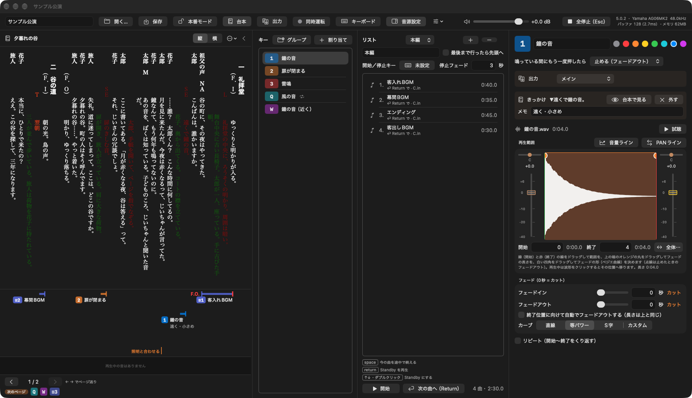
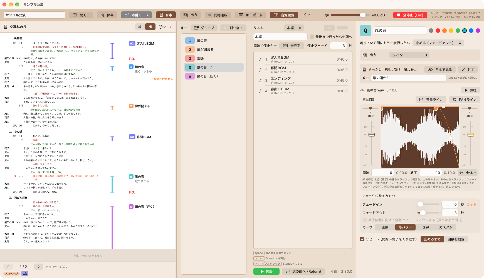
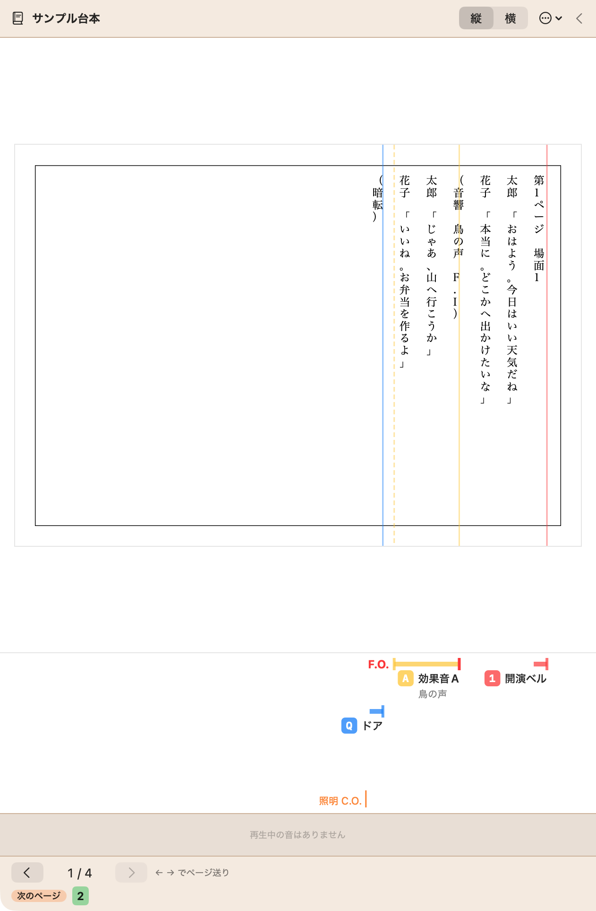
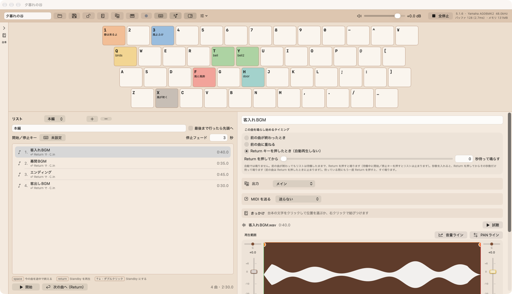
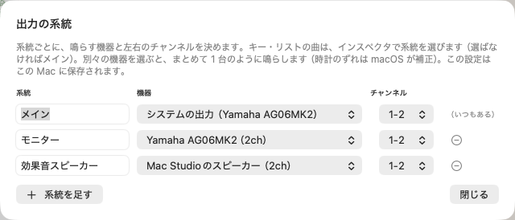
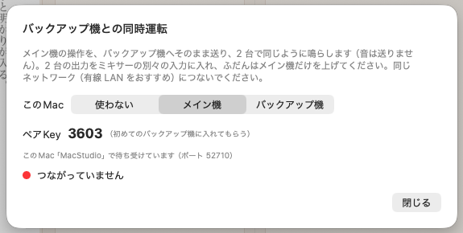
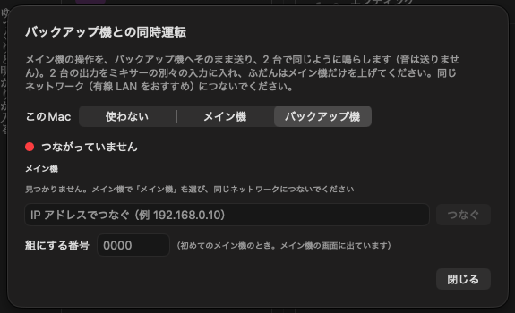
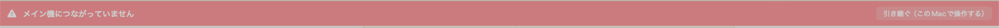

<!-- _class: lead -->
<!-- _paginate: false -->
<!-- _footer: "" -->

# CacaoSoundCues Pro マニュアル

台本と連動する、舞台のポン出し音響アプリ
バージョン 5.0.2 ／ 2026 年 10 月

---

## このマニュアルで分かること

1. Pro 版でできること（無料版との違い）
2. 台本を取り込んで表示する
3. きっかけを台本に結びつける（きっかけの帯）
4. 本番で台本を追う・帯から鳴らす
5. 出力の系統（複数のスピーカー・機器へ出す）
6. バックアップ機との同時運転
7. 保存されるもの・困ったとき

> キーやリストの基本の使い方（音の割り当て・フェード・リスト・本番モード）は、無料版の **CacaoSoundCues マニュアル** をご覧ください。Pro 版も同じ操作です。

---

## Pro 版でできること

### 台本連動

- ScenarioWriterSolo の台本（.scwd）か、ふつうの **PDF** の台本を、主画面の横に出す
- キー・リストの曲を、台本の**文字の位置**に結びつける
- ページの下に**きっかけの帯**（音響台本の書き方）

### 出力の系統

- キー・曲ごとに、出すスピーカー（機器とチャンネル）を選ぶ

### バックアップ機との同時運転

- メイン機の操作を、もう 1 台の Mac にそのまま送って同じように鳴らす
- メイン機が止まっても、バックアップ機で続けられる

### 無料版との関係

- キューシート（.ccsc）は無料版と同じもの。Pro 版で作ったキューシートを無料版で開いても壊れない（台本の結びつきなどは無視される）

---

## 1. インストールと起動

1. **CacaoSoundCuesPro.zip** をダブルクリックして展開
2. **CacaoSoundCuesPro** を **アプリケーション** フォルダへ移す
3. ダブルクリックで起動

無料版（CacaoSoundCues）と並べて入れておけます。設定は別々に保存されます。

**「開発元を確認できない」などの警告が出たら**
macOS 15 以降：警告を閉じ、**システム設定 › プライバシーとセキュリティ** の **「このまま開く」**。
macOS 14：アプリを **右クリック →「開く」→「開く」**。

**「ローカルネットワーク上のデバイスの検出」を聞かれたら**
同時運転で、同じネットワークの Mac とつなぐために使います。**許可** してください。

---

## 2. 画面の見かた

左：台本のパネル（下はきっかけの帯、その下に鳴っている音の波形とページ送り） ／ 中：キーの一覧とリスト ／ 右：選んだ音の設定（「出力」と「きっかけ」の欄が Pro 版のもの）

---

## 3. 上の帯のボタン

| ボタン | すること |
|---|---|
| **台本** | 台本のパネルを出す・隠す |
| **出力** | 出力の系統（機器とチャンネル）を決める → 9 章 |
| **同時運転** | バックアップ機との同時運転 → 10 章。丸の色：灰＝使わない、緑＝つながっている、橙＝キューシートが違う、赤＝切れている |
| **キーボード** | キーボードを出す・隠す（隠すと割り当てたキーの一覧） |
| **音源設定** | 右側の設定を出す・隠す。隠すと台本を広く使える |

画面の狭い Mac（ノートなど）では、ボタンが絵だけになります。マウスを載せると名前が出ます。

---

## 4. 台本を取り込む

1. 台本のパネルの **⋯** →「**台本を取り込む…**」
2. ScenarioWriterSolo の台本（**.scwd**）か **PDF** を選ぶ（PDF は次の次のページ）
3. 台本がキューシートの中にコピーされる

- 台本を直したら「**台本を読み込み直す**」
- 台本の行は、ScenarioWriterSolo が行ごとに付ける印で探すので、直しても結びつきがずれにくい

### 表示を整える（⋯ メニュー）

- **縦・横**：縦書き・横書き
- **文字の大きさ**（上限）・**行間**・**文字間**
- **人物名欄の字数**・**本文 1 行の字数**：ふだんは台本の書式どおり。このキューシートだけ変えられる

1 行は台本の書式（人物名欄＋本文の字数）で折り返すので、紙の台本と同じ位置で折れます。入りきらないときは文字が小さくなります。表示の設定はキューシートに保存されます。

---

## 縦書きと横書き

横書きでは、きっかけの帯はページの右に出ます（線は上から下へ）。

---

## PDF の台本（ScenarioWriterSolo 以外）

- 「**台本を取り込む…**」で **PDF** も選べる（1 ページずつ、そのまま出す）
- **文字の大きさ・字数・行間は変えられない**
- **縦・横**は台本の向き（縦：帯は下、<kbd>←</kbd> が次 ／ 横：帯は右）
- ページ送り・きっかけの帯は .scwd の台本と同じ
- ページの上にも、きっかけの位置に**色の線**

縦・横は結びつける前に決めてください（あとで変えると線の位置が変わります）。鍵の掛かった PDF は読めません。

---

## 5. ページを送る・流す

### ページ送り

- <kbd>←</kbd> <kbd>→</kbd> か、下の ‹ ›
- 縦書きは本と同じく <kbd>←</kbd> が次のページ

### スクロールで流す

- マウスのホイール・**横スクロール**（横のダイヤル）、トラックパッドで、巻物のように流せる
- 止めたところで止まる（2 ページの途中も見られる）

### パネルの広さ

- 台本と主画面の間の仕切りをドラッグ
- 右端まで引くと、台本を**窓いっぱい**に（主画面を隠す。キーや Return はそのまま効く）
- 見出しの **‹** で、台本を**左に畳む**（左端の細い帯で開く）

### 次のページ

- 下の「**次のページ**」に、次のページのきっかけの札が出る

---

## 台本を畳む

畳むと、主画面が台本のぶんまで広がります。左端の細い帯を押すと、台本が開きます。

---

## 6. きっかけを結びつける

### 帯で（おすすめ）

1. キーの一覧かリストで、キー・曲を選ぶ
2. ページの下の**きっかけの帯**の、その位置を**右クリック**
3. 「**○○ を、ここのきっかけにする**」

クリックしたところに線が始まります（行間でもよい）。

### 文字で

- 台本の文字を右クリックして結びつけることもできる
- インスペクタの「きっかけ」の欄で、台本の位置を見る・外す

### 止める位置（線の終わり）

- 帯を右クリック →「**ここで止める**」
- 線をそこまで伸ばし、**F.O.**（フェードアウトのとき）か **C.O.** と書く
- ページをまたぐ線も、次のページへ続けて描く

### 線の位置を直す

- 線の始まり・終わりの縦の印を**ドラッグ**
- 印を**ダブルクリック**で、文字の位置に戻す

---

## きっかけの帯の見かた

- 札：**押すキー**（キーの色）か、リストの曲（**≡** と番号）
- 名前の下に**メモ**（例「遠く・小さめ」）。インスペクタの「メモ」か、帯の右クリックで書く
- 線：きっかけから止める位置まで。鳴っている間は太くなる
- オレンジの文字：きっかけに属さない**書き込み**（例「照明と合わせる」）

> 紙の台本に鉛筆で A・S などのキーを書き込むのと同じように、押すものが直接分かります。

---

## 帯の右クリック

| 右クリックしたところ | できること |
|---|---|
| 何もないところ | 選んだキー・曲を **ここのきっかけにする** ／ **ここで止める** ／ **ここにメモを書く…** |
| 札・線 | **鳴らす** ／ **止める**（鳴っているとき） ／ メモを書く ／ ここで止める 線の位置を文字に戻す ／ 止める位置を外す ／ **結びつきを外す**（台本から消す） |
| 書いたメモ | メモを直す ／ メモを消す |

本番モード中は「鳴らす」「止める」だけです。

---

## 7. 本番で台本を使う

### 帯から鳴らす・止める

- 帯の札・線を <kbd>⌘</kbd>＋クリック か <kbd>control</kbd>＋クリック で**鳴らす**
- 右クリック →「**止める（フェードアウト）**」で、その音だけを止める（Esc の全停止ではない）

### 自動でページを送る

- ⋯ →「**Standby のきっかけへ自動でページを送る**」（ふだんは OFF。自分で送る）

### 鳴っている音の波形

- 台本の下に、鳴っている音の波形が横長に出る（最大 3 つ）
- 鳴り終えたところは濃く、いまの位置に白い線、右に**残り時間**
- 黄色の横線は**いまの音量**（フェード・音量ラインに合わせて上下）

本番モード中は、結びつけや書き込みは変えられません（鳴らす・止めるはできます）。

---

## 8. キューシートに保存されるもの

キューシート（.ccsc）の中に、Pro 版のものも入ります。

- **pro.json**：結びつき・止める位置・線の位置・メモ・書き込み・表示の設定・キー・曲の出力の系統
- **Script/**：取り込んだ台本（.scwd か PDF）のコピー

- 無料版はこれらに触らないので、**無料版で開いて保存しても消えません**
- キューシートごと別の Mac に持っていけば、台本も一緒に移る

出力の系統の機器の設定と、同時運転の役は、Mac ごとに保存されます（キューシートには入りません）。

---

## 9. 出力の系統（複数の出力）

1. 上の帯の **出力** を押す
2. 系統ごとに **名前**・**機器**・**チャンネル**（1-2、3-4 …）を決める。最初の系統が**メイン**
3. 「系統を足す」で増やす
4. キー・リストの曲を選び、インスペクタの「**出力**」で系統を選ぶ（選ばなければメイン）

**別々の機器**を選ぶと、まとめて 1 台のように鳴らします（時計のずれは macOS が補正。サンプルレートはメインの機器にそろえる）。系統が違っても、リストの曲のつなぎはずれません。

---

## 出力の系統の注意

- 系統の**機器の設定はこの Mac に保存**されます。キー・曲には**系統の名前**で保存されるので、別の Mac でも同じ名前の系統を作れば同じように出ます（無い名前ならメインに出ます）
- 決めた機器で鳴らせないとき（つながっていない・使えない状態）は、**システムの出力**で鳴らし、出力の画面に知らせます
- 機器を抜き差ししたときは、自動で当て直します
- 系統の設定を変えると、鳴っている音はいったん止まります。**本番の前に**決めてください
- メインだけで「システムの出力の 1-2」のときは、無料版と同じ出し方です

---

## 10. バックアップ機との同時運転

### しくみ

- メイン機の**操作**（鳴らす・止める・Standby・リストの開始停止・Esc・全体の音量・台本のページとスクロール）を、バックアップ機へそのまま送る
- **音は送りません**。2 台とも自分の機器から鳴らす
- 2 台の出力をミキサーの**別々の入力**に入れ、ふだんはメイン機だけを上げる。メインが止まったら、ミキサーでバックアップ機に切り替える

### 用意するもの

- Mac 2 台（**同じ機種をおすすめ**。画面の見え方がそろう）
- 同じネットワーク（**有線 LAN をおすすめ**）
- 両方に CacaoSoundCues Pro

遅れは LAN で 1〜数ミリ秒です。2 台を同時に上げると音が濁るので、ミキサーではどちらか一方だけを上げてください。

---

## 同時運転：つなぐ

1. **メイン機**：上の帯の **同時運転** →「**メイン機**」。**ペアKey**（4 桁）が出る
2. **バックアップ機**：「**バックアップ機**」→ 見つかったメイン機の「つなぐ」（見つからなければ **IP アドレス**でつなぐ）。初めての相手のときは**ペアKey**も入れる
3. つながると、丸が**緑**に。遅れ（ms）が出る

一度組にした相手は覚えているので、次からはペアKeyは要りません。

---

## 同時運転：キューシートをそろえる

- つなぐと、2 台のキューシートが**同じか**照らし合わせる
- 違うとき：メイン機で**保存**してから「**バックアップ機へキューシートを送る**」（バックアップ機からは「メイン機のキューシートをもらう」）
- 音ファイル・台本ごと送り、バックアップ機で自動で開く

> 未保存の変更がある間は「違う」と出ます。本番の前に、メイン機で保存して送り、「**キューシートは同じです**」になっていることを確かめてください。

受け取ったキューシートは、バックアップ機の「アプリケーションサポート › CacaoSoundCuesPro › FromMain」に置かれます。

---

## 同時運転：本番と引き継ぎ

- バックアップ機は、上に**青い帯**（メイン機の操作どおりに鳴らしている）
- バックアップ機の**手の操作は効きません**（全体の音量と Esc は効きます）
- メイン機と**切れる**と（2 秒合図が届かない）、バックアップ機に**赤い帯**。鳴っている音はそのまま続く
- 「**引き継ぐ（この Mac で操作する）**」で、バックアップ機がメイン機になる
- 元のメイン機を起動し直すと、**バックアップ機**になって合わせる（役の入れ替え）

メイン機と切れたとき・つながっていないときの赤い帯（右端に「引き継ぐ」）

---

## 11. 困ったとき

| こんなとき | 見るところ |
|---|---|
| きっかけが「見つかりません」 | 台本を直して行が消えた。帯で結びつけ直す |
| 台本の文字が小さい | 1 行が入りきらない。パネルを広げる・字数や文字間を見直す |
| PDF の台本が小さい・読めない | パネルを広げる（文字の大きさは変えられない）。鍵付きの PDF は読めない |
| 系統に選んだ機器から鳴らない | 出力の画面の知らせ。機器がつながり、Mac で使えるか |
| バックアップ機が見つからない | 同じネットワークか・ローカルネットワークの許可・IP でつなぐ |
| バックアップ機が違う音を鳴らす | キューシートが同じか（同時運転の画面）。メイン機から送り直す |
| バックアップ機で操作できない | 正しい動きです。操作するときは「引き継ぐ」 |

基本の操作（キー・リスト・本番モード・設定）の困ったときは、無料版の CacaoSoundCues マニュアルをご覧ください。
